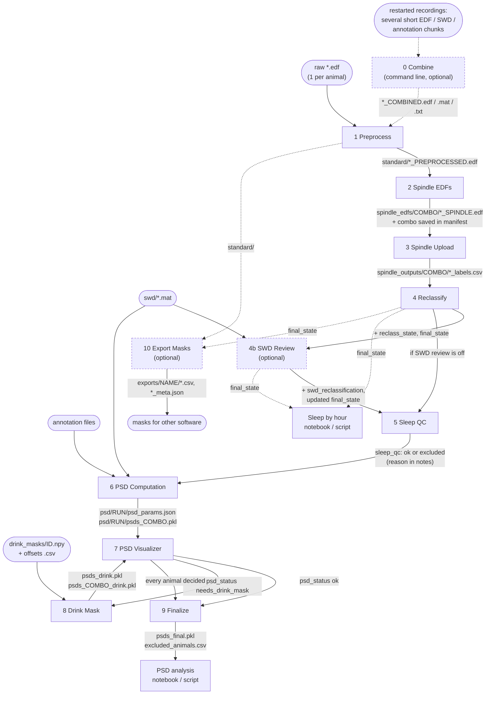

# ebb-viewer overview

This page is the map: what each
step takes in and puts out, where files live, and which page explains what. For how to run a step, open its page. For
terms, see [glossary.md](glossary.md).

## The pipeline in one picture

Boxes are steps; an arrow is the file or folder handed to the next step. Rounded boxes are files you prepare yourself.
Dashed boxes are optional.



The [EEG viewer](steps/eeg_viewer.md) is not a step: you open it from Home to look at one animal and settle it in Sleep QC.

## The steps

"Writes" lists files; "Records" lists what goes into `manifest.json`. Each step name links to its page.

| # | Step | You provide | Reads | Writes | Records |
|---|---|---|---|---|---|
| 0 | [Combine](steps/00_combine.md) (optional, command line) | Short EDF, SWD and annotation chunks of a restarted recording | the chunks | `*_COMBINED.edf`, `.mat`, `.txt`; originals to `short_files/` | – |
| 1 | [Preprocess](steps/01_preprocess.md) | Raw EDFs; sampling rate, downsample factor, trim lengths | `*.edf` in the project folder | `standard/<name>_PREPROCESSED.edf` (250 Hz, whole days) | an entry per animal |
| 2 | [Spindle EDFs](steps/02_spindle_edfs.md) | 1 or 2 EEG channels | `standard/` | `spindle_edfs/<COMBO>/<name>_SPINDLE.edf` | **the project combo**; `has_spindle` |
| 3 | [Spindle Upload](steps/03_spindle_upload.md) | SleepyRat sign-in, project and remote folder | `spindle_edfs/<COMBO>/` | `spindle_outputs/<COMBO>/<name>_labels.csv` | `has_spindle` |
| 4 | [Reclassify](steps/04_reclassify.md) | Click Run | label CSVs, `standard/` | adds `reclass_state`, `final_state`, `emg_gate` to each CSV; untouched copy in `_original/` | `reclass_gate_applied`, flips kept and cancelled |
| 4b | [SWD Review](steps/04b_swd_review.md) (optional) | One SWD `.mat` per animal; epoch corrections | `swd/`, label CSVs, `standard/` | adds `swd_reclassification`, updates `final_state` | `swd_review_enabled`, `swd_reviewed`, `swd_total`, `swd_waived` |
| 5 | [Sleep QC](steps/05_sleep_qc.md) | OK, Review or Exclude for every animal (a reason for exclusions) | `final_state`, EDF start times | – | `sleep_qc`, `flag_reasons`, `notes` |
| 6 | [PSD Computation](steps/06_psd_computation.md) | States, channels, masks, run name; annotation files | `standard/`, label CSVs, `swd/`, annotation files | `psd/<RUN>/psd_params.json`, `psds_<COMBO>.pkl` | clears the run's `psd_status` |
| 7 | [PSD Visualizer](steps/07_psd_visualizer.md) | OK or Drink Mask per animal; Mask worked or Redo | the run's PSD files | – (the PSD files are never changed) | `psd_status[RUN]`, `notes`; exclusions |
| 8 | [Drink Mask](steps/08_drink_mask.md) (only if flagged) | `drink_masks/<ID>.npy` per flagged animal; offsets CSV | `psd_params.json`, `standard/`, `drink_masks/` | `psds_drink.pkl`, `psds_<COMBO>_drink.pkl` | `psd_status[RUN]` = `drink_mask_applied`; `drink_mask` |
| 9 | [Finalize](steps/09_finalize.md) | Click Finalize per run | the drink-masked PSD file if it exists, else `psds_<COMBO>.pkl`; the manifest | `psd/<RUN>/psds_final.pkl`, `excluded_animals.csv`; optional Excel | – |
| 10 | [Export Masks](steps/10_export_masks.md) (optional) | Settings, animals, export name | `standard/`, label CSVs, optional SWD, annotation and drink files | `exports/<NAME>/<animal>_<combo>_{states,artifacts,clean_per_state}.csv`, `_meta.json` | – |
| – | [PSD analysis](steps/analysis_notebooks.md) | `RUNS`, groups | `psds_final.pkl` | `psd_analysis/<RUN>/` figures, band power CSVs, Prism workbooks | – |
| – | [Sleep by hour](steps/analysis_notebooks.md) | Project folder, groups, time zone | `manifest.json`, label CSVs, EDF headers | `sleep_analysis/` tables, Prism workbooks, plots | – |

Order matters only where an arrow says so. In practice: finish 1 to 3 for every animal before 4; give every animal a Sleep QC
decision (5) before computing PSDs (6); and finish the review loop (7, 8, then 7 again) before Finalize (9).

## The project folder

Everything for one time point lives in one folder. The app creates what you do not prepare.

```
<project>/
  *.edf                         your raw recordings (one per animal)
  short_files/                  original restart chunks, after Combine
  standard/                     1  preprocessed EDFs
  spindle_edfs/<COMBO>/         2  SPINDLE EDFs
  spindle_outputs/<COMBO>/      3  label CSVs; 4 and 4b add columns
    _original/                     SleepyRat's untouched CSVs
  swd/                          SWD .mat files, one per animal  (you provide)
  drink_masks/                  <ID>.npy per flagged animal, and one offsets .csv  (you provide)
  psd/<RUN>/                    6 to 9  psd_params.json, psds_<COMBO>.pkl, psds_drink.pkl,
                                psds_<COMBO>_drink.pkl, psds_final.pkl, excluded_animals.csv
  exports/<NAME>/               10  mask interval files and export_params.json
  psd_analysis/<RUN>/           PSD analysis results
  sleep_analysis/               sleep by hour results
  manifest.json                 the project's record: combo, per-animal decisions. Do not edit by hand.
```

Annotation files can live anywhere; you pick their folder on the PSD page. The SleepyRat sign-in is stored once per computer, in
`~/.config/ebb/sleepyrat.json`.

## Rules that run through every step

- **Animal ID** is the part of a file name before the first `_`. It must be identical, including capitals, in every file of an
  animal. **No spaces anywhere in file, folder or SleepyRat project names**: SleepyRat fails on them.
- **Channel order** is LFC, RSC, LSC, EMG, by position. Nothing checks the names.
- **One channel combo per project.** It is set when the SPINDLE EDFs are written. Changing it later means scoring everything again.
- **One project folder per time point,** so animal IDs do not collide.
- **All analysis reads `final_state`,** the reclassified states, never SPINDLE's original ones. A CSV without it stops the step.
- **Exclusions keep the data.** An excluded animal is still computed, kept in the sealed PSD file and marked with its reason. Leave it
  out when you analyse. Exports from step 10 do not mark it.
- **The manifest is the record.** The Home page reads it. Sealed files hold a snapshot of the exclusions from the day you finalized.

## Statuses

| Field | Values | Set by |
|---|---|---|
| `sleep_qc` | none, `ok`, `needs_review`, `excluded` | Sleep QC, Home, the EEG viewer, the PSD Visualizer (Exclude) |
| `psd_status` (per PSD run) | none, `ok`, `needs_drink_mask`, `drink_mask_applied` | PSD Visualizer, Drink Mask. Exists only while `sleep_qc` is `ok`. |
| `reclass_gate_applied` | none, true, false | Reclassify |
| `swd_reviewed`, `swd_total`, `swd_waived` | counts and a flag | SWD Review |

"Decided" in Sleep QC means `ok` or `excluded`. PSD Computation needs every animal decided; the review queues in steps 7 and 8 contain
only `ok` animals.

## Things that catch people out

Each is explained on the page named.

- Re-scoring an animal in SleepyRat needs the old entry deleted on the SleepyRat site as well as the local label CSV ([step 3](steps/03_spindle_upload.md)).
- Re-running a PSD run that already has drink masks leaves the old drink files, and Finalize seals them ([step 6](steps/06_psd_computation.md), [step 8](steps/08_drink_mask.md), [step 9](steps/09_finalize.md)).
- Re-finalizing overwrites `psds_final.pkl` without asking, and exclusions in it are a snapshot ([step 9](steps/09_finalize.md)).
- Interpolate and Inverse Filter in the PSD Visualizer start switched off ([step 7](steps/07_psd_visualizer.md)).
- Switching an animal away from `ok` in Sleep QC clears its PSD review progress ([step 5](steps/05_sleep_qc.md)).
- "Confirm no SWD" does not satisfy the PSD SWD mask; every animal then still needs a `.mat` file ([step 4b](steps/04b_swd_review.md)).
- Sleep-by-hour numbers changed when bouts began to be counted once, in the bin holding most of each ([analysis page](steps/analysis_notebooks.md)).

## Where to read what

| You want | Read |
|---|---|
| To get a first project running | the [quick start](quick_start.md) |
| What a step needs, what you can change, what it writes, and what every setting and output means | the step page |
| What a term means | [glossary.md](glossary.md) |
| Why the pipeline works this way | [decision_log.md](decision_log.md) |
| The exact methods for a paper | the [methods draft](methods_bullets.md) |
