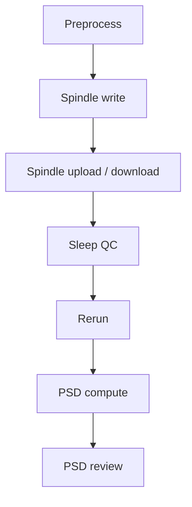
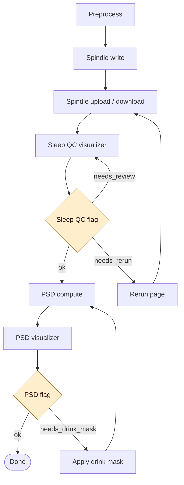
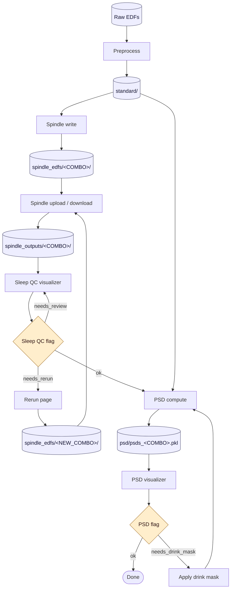

# Pipeline Workflow

Three flowcharts of the ebb pipeline, at increasing levels of detail.
Each chart is given in Mermaid (renders in GitHub / IDEs) and as an
ASCII fallback.

---

## 1. High-level stages

The seven pipeline stages, in order.

### Mermaid



### ASCII

```
+------------+   +---------------+   +----------------------+
| Preprocess |-->| Spindle write |-->| Spindle upload/dl    |
+------------+   +---------------+   +----------+-----------+
                                                |
                                                v
+-------------+   +--------+   +----------+   +-----------+
| PSD review  |<--| PSD    |<--|  Rerun   |<--| Sleep QC  |
+-------------+   +--------+   +----------+   +-----------+
```

---

## 2. Stages + decision points

Adds the two manifest-driven decision gates: sleep-QC flagging and PSD
flagging. Each gate can loop work back to an earlier stage.

### Mermaid



### ASCII

```
  +------------+
  | Preprocess |
  +-----+------+
        v
  +---------------+
  | Spindle write |
  +-----+---------+
        v
  +-----------------------+
  | Spindle upload / dl   |<------------------+
  +-----+-----------------+                   |
        v                                     |
  +---------------------+                     |
  | Sleep QC visualizer |<----+               |
  +-----+---------------+     |               |
        v                     | needs_review  |
   /-----------\              |               |
  < Sleep QC?  >--------------+               |
   \-----+-----/  needs_rerun                 |
     ok  |    +--------------> +-----------+  |
         |                     |  Rerun    |--+
         v                     +-----------+
  +-------------+
  | PSD compute |<-------------------+
  +-----+-------+                    |
        v                            |
  +-----------------+                |
  | PSD visualizer  |                |
  +-----+-----------+                |
        v                            |
   /-----------\                     |
  <  PSD flag?  >--------------------+
   \-----+-----/   needs_drink_mask  |
     ok  |         +--------------+  |
         v         | Apply drink  |--+
       +----+      |    mask      |
       |Done|      +--------------+
       +----+
```

---

## 3. Stages + inputs/outputs (full picture)

Stages, decision gates, **and** the on-disk artifacts produced at each
step. Cylinders are directories or files on disk.

### Mermaid



### ASCII

```
              +------------------+
              |    Raw EDFs      |
              +--------+---------+
                       v
              +------------------+
              |    Preprocess    |
              +--------+---------+
                       v
              +------------------+
              |    standard/     |---------------+
              +--------+---------+               |
                       v                         |
              +------------------+                |
              |  Spindle write   |                |
              +--------+---------+                |
                       v                         |
           +-----------------------+              |
           | spindle_edfs/<COMBO>/ |<--+          |
           +-----------+-----------+   |          |
                       v               |          |
           +-----------------------+   |          |
           | Spindle upload / dl   |   |          |
           +-----------+-----------+   |          |
                       v               |          |
          +--------------------------+ |          |
          | spindle_outputs/<COMBO>/ | |          |
          +-----------+--------------+ |          |
                      v                |          |
           +-----------------------+   |          |
           | Sleep QC visualizer   |<--+--+       |
           +-----------+-----------+   |  |       |
                       v               |  | needs_review
                  /---------\          |  |       |
                 < QC flag? >----------+--+       |
                  \----+----/   needs_rerun       |
                       | ok                       |
                       |    +-----------+         |
                       |    |   Rerun   |<--------+
                       |    +-----+-----+         |
                       |          v               |
                       | +------------------------+|
                       | |spindle_edfs/<NEW_COMBO>/|
                       | +-----------+------------+|
                       |             +-> (Upload) +|
                       v
              +------------------+   <----- standard/
              |   PSD compute    |<--+
              +--------+---------+   |
                       v             |
          +---------------------------+
          | psd/psds_<COMBO>.pkl      |
          +-------------+-------------+
                        v
              +------------------+
              |  PSD visualizer  |
              +--------+---------+
                       v
                  /----------\
                 < PSD flag?  >---+
                  \----+-----/    | needs_drink_mask
                   ok |           v
                      |  +------------------+
                      |  | Apply drink mask |--+
                      |  +------------------+  |
                      |          (back to PSD compute)
                      v
                    +----+
                    |Done|
                    +----+
```

---

## Notes

- `COMBO` is a channel-combo string like `LFC_RSC`, used as both a
  directory name and a manifest key.
- The Rerun page produces a new `<NEW_COMBO>` (different channel pair)
  and re-enters the upload step; the original combo's run stays in the
  manifest so the user can still ✓ Accept it from review mode.
- Sleep QC flags: `None | "ok" | "needs_review" | "needs_rerun"`.
- PSD flags: `None | "ok" | "needs_drink_mask" | "drink_mask_applied"`.
- `Manifest.build_from_standard()` syncs new files from disk without
  overwriting existing flags — re-running earlier stages does not clear
  downstream decisions.
