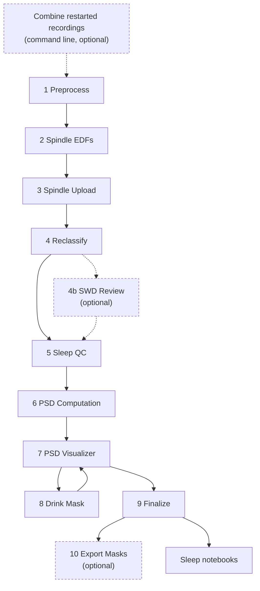
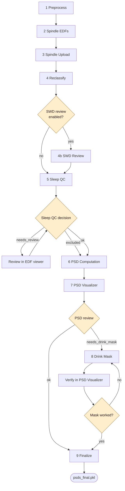
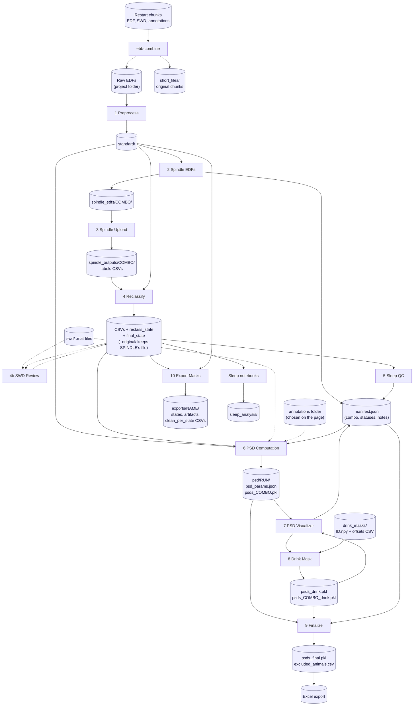

# Pipeline workflow

Three flowcharts of the ebb pipeline, at increasing levels of detail.
Each chart is given in Mermaid (renders in GitHub / IDEs) and as an
ASCII fallback. Step numbers match the sidebar of ebb-viewer; how to run
each step is in [user_guide.md](user_guide.md).

---

## 1. High-level stages

The stages in order. Dashed boxes are optional.

### Mermaid



### ASCII

```
 - - - - - - - - - - - - - -
 : Combine restarts (CLI)   :
 - - - - - - - - - - - - - -
              v
+------------+   +-----------------+   +------------------+
|1 Preprocess|-->|2 Spindle EDFs   |-->|3 Spindle Upload  |
+------------+   +-----------------+   +---------+--------+
                                                 v
 +----------------+   - - - - - - - - -   +--------------+
 |5 Sleep QC      |<--: 4b SWD Review  :<--|4 Reclassify  |
 +-------+--------+   - - - - - - - - -   +--------------+
         v   (4b is optional; 4 can go straight to 5)
 +---------------+   +----------------+   +--------------+
 |6 PSD Compute  |-->|7 PSD Visualizer|<->|8 Drink Mask  |
 +---------------+   +-------+--------+   +--------------+
                             v
                     +--------------+   - - - - - - - - -
                     |9 Finalize    |-->: 10 Export Masks:
                     +------+-------+   - - - - - - - - -
                            v
                     Sleep notebooks
```

---

## 2. Stages + decision points

Adds the decision gates, and the loops they create.

- **Sleep QC** decides each animal: `ok`, `needs_review` (look again, then `ok` or `excluded`) or `excluded`. An excluded animal is still computed and is marked at Finalize.
- **PSD review** decides each `ok` animal: `ok` or `needs_drink_mask`. A drink-masked animal is recomputed and verified: **Mask worked** gives `ok`, **Redo mask** goes back to `needs_drink_mask`.
- **Finalize** waits until no animal is unreviewed, flagged, or waiting for verification.

### Mermaid



### ASCII

```
 1 Preprocess -> 2 Spindle EDFs -> 3 Spindle Upload -> 4 Reclassify
                                                            |
                                  SWD review enabled?  yes  |  no
                                         +------------------+--------+
                                         v                           |
                                 4b SWD Review                       |
                                         |                           |
                                         v                           v
                                       +---------------------------------+
                                       |          5 Sleep QC             |<--+
                                       +----------------+----------------+   |
                                                        v                    |
                                                 /-------------\             |
                                                < QC decision?  >-------------+
                                                 \------+------/  needs_review
                                              ok /      | excluded  (review EDF,
                                                 +------+           then ok/excluded)
                                                        v
                                               6 PSD Computation
                                                        v
                                               7 PSD Visualizer
                                                        v
                                                 /-------------\
                                                <  PSD review?  >--- needs_drink_mask
                                                 \------+------/            |
                                                   ok   |                    v
                                                        |           8 Drink Mask (rerun)
                                                        |                    v
                                                        |            Verify: mask worked?
                                                        |             yes |       | no
                                                        |<----------------+       +--> back to 8
                                                        v
                                                  9 Finalize
                                                        v
                                                 psds_final.pkl
```

---

## 3. Stages + inputs/outputs (full picture)

The folders and files each step reads and writes, under the project folder.
Cylinders are folders or files on disk.

### Mermaid



### Folder layout (ASCII)

```
project/
  *.edf                       raw recordings (one per animal)
  short_files/                original restart chunks, after ebb-combine
  standard/                   1 Preprocess
  spindle_edfs/COMBO/         2 Spindle EDFs
  spindle_outputs/COMBO/      3 Spindle Upload; 4 Reclassify adds columns
    _original/                SPINDLE's untouched CSVs
  swd/                        SWD .mat files (one per animal)
  drink_masks/                ID.npy per animal + one offsets CSV
  psd/RUN/                    6-9: psd_params.json, psds_COMBO.pkl,
                              psds_drink.pkl, psds_COMBO_drink.pkl,
                              psds_final.pkl, excluded_animals.csv
  exports/NAME/               10 Export Masks
  sleep_analysis/             sleep notebooks
  manifest.json               project combo and per-animal statuses
```

---

## Notes

- `COMBO` is the project's channel combo (for example `LFC_RSC`), set when the SPINDLE EDFs are written. A project has exactly one combo; there is no per-animal combo and no Rerun page.
- Sleep QC statuses: `None | "ok" | "needs_review" | "excluded"`. PSD statuses: `None | "ok" | "needs_drink_mask" | "drink_mask_applied"`. An exclusion needs a written reason.
- Everything downstream of Reclassify reads `final_state`, not SPINDLE's original states.
- `Manifest.build_from_standard()` syncs new files from disk without overwriting existing flags, so rerunning an earlier step does not clear later decisions.
- The annotation folder is chosen on the PSD Computation page and is not required to live in the project folder.
