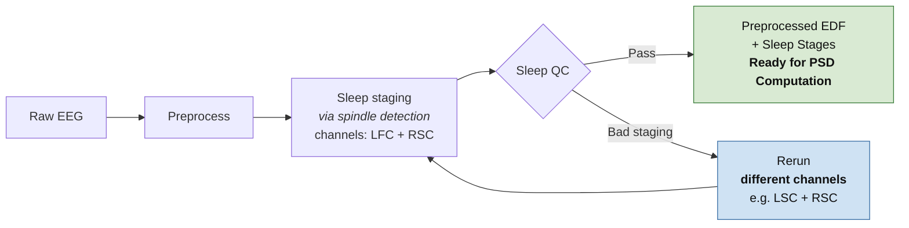

# Pipeline Flow — Slide

Simple flowchart for a presentation. The key idea: a spindle *rerun*
is just re-running sleep staging with a different channel combination.

## Mermaid



## ASCII

```
                                              +----------------------+
                                              |   Rerun              |
                                              | (different channels) |
                                              |   e.g. LSC + RSC     |
                                              +----------+-----------+
                                                         ^
                                                         |  Bad staging
                                                         |
+---------+   +------------+   +------------------+   +--+-------+   +--------------------+
| Raw EEG |-->| Preprocess |-->|  Sleep staging   |-->| Sleep QC |-->| Preprocessed EDF   |
+---------+   +------------+   | via spindle det. |   +----------+   | + Sleep Stages     |
                               | ch: LFC + RSC    |       Pass       | Ready for PSD comp.|
                               +------------------+                  +--------------------+
```
