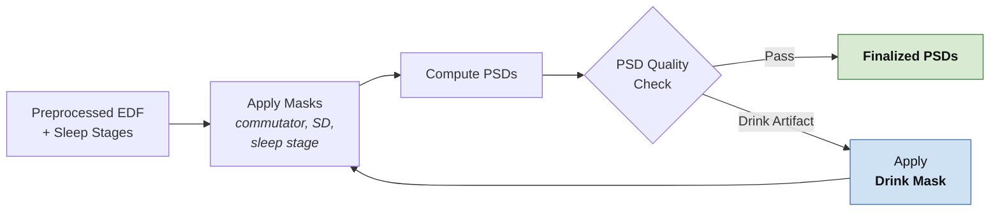

# Stage 2: PSD Computation — Slide

Companion to the **Stage 1: Data Preparation** slide. Picks up from
the *Preprocessed EDF + Sleep Stages — Ready for PSD Computation*
terminal box and shows how those inputs become finalized PSDs.

The layout mirrors Stage 1 exactly: linear left-to-right flow, decision
diamond, blue "fix" box on a loop-back arrow, green terminal box.

## Mermaid



## ASCII

```
                                                                +-----------+
                                                                | Finalized |
                                                                |   PSDs    |
                                                                +-----------+
                                                                      ^
                                                                      | Pass
                                                                      |
+--------------+   +-------------+   +---------+    /--------------\
| Preprocessed |-->| Apply Masks |-->| Compute |-->< PSD Quality    >
| EDF + Sleep  |   | commutator, |   |  PSDs   |    \  Check        /
| Stages       |   | SD, stage   |   +---------+     \------+------/
+--------------+   +------+------+                          |
                          ^                                 | Drink
                          |                                 | artifact
                          |                                 v
                          |                       +-------------------+
                          +-----------------------|  Apply            |
                                                  |  drink mask       |
                                                  +-------------------+
```

## Visual parity with the Stage 1 slide

| Stage 1                              | Stage 2 (this slide)               |
| ------------------------------------ | ---------------------------------- |
| Raw EDF (input box)                  | Preprocessed EDF + Sleep Stages    |
| Sleep Staging (work step)            | Apply Masks                        |
| —                                    | Compute PSDs                       |
| Sleep Quality Check (diamond)        | PSD Quality Check (diamond)        |
| Pass → Ready for PSD Computation     | Pass → Finalized PSDs (green)      |
| Bad Staging → Rerun w/ new channels  | Drink Artifact → Apply Drink Mask  |
| Loop back to Sleep Staging           | Loop back to Apply Masks           |

## Notes for the slide

- The input box ("Preprocessed EDF + Sleep Stages") should look
  identical to the terminal box on Stage 1 — same wording, same
  styling. This sells the hand-off when you advance slides.
- Color the *Apply Drink Mask* box the same blue you used for *Rerun*
  on Stage 1. Same role (the loop-back fix), same color.
- Color the *Finalized PSDs* box the same green you used for *Ready for
  PSD Computation*. Both are terminals.
- "Apply Masks" reads cleaner than enumerating each mask in the box
  title. Use the italic sub-line (commutator, SD, sleep stage) to show
  what's in the bundle without crowding the box.
- The drink-mask arrow returns to *Apply Masks* (not directly to
  *Compute PSDs*) because conceptually the drink mask is an addition to
  the mask set — narratively cleaner, visually parallel to Stage 1's
  Rerun → Sleep Staging loop.
