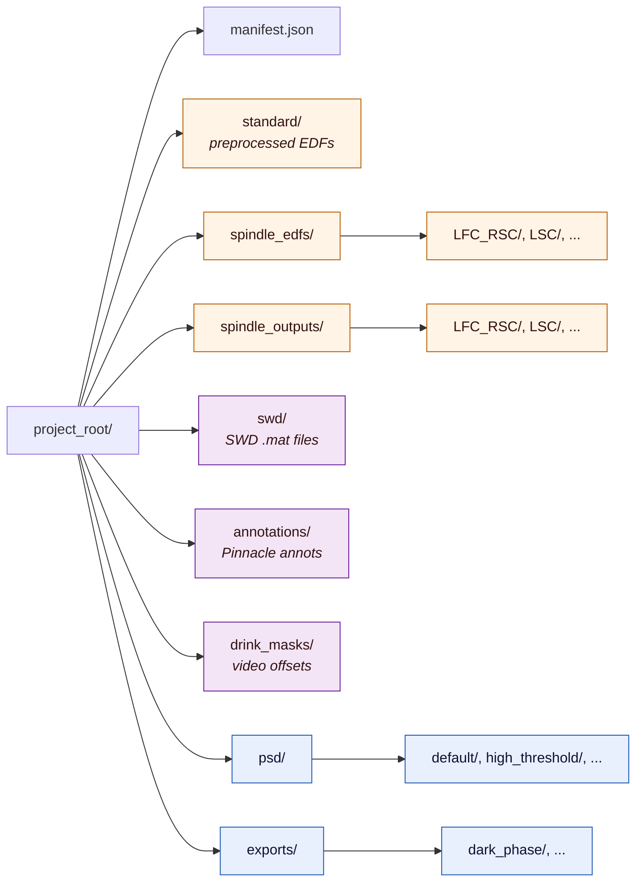

# Appendix: Project Storage Layout — Slide

Reference slide for the deck appendix. Shows where each pipeline stage
writes on disk and surfaces three key patterns:

1. **Per-combo subdirectories** in `spindle_edfs/` and
   `spindle_outputs/` (channel pair → folder name).
2. **Named runs** for `psd/<run>/` and `exports/<name>/` — multiple
   parameter sets coexist without overwriting.
3. **External input directories** (`swd/`, `annotations/`,
   `drink_masks/`) that Stage 2 reads from but doesn't itself
   populate — they come from outside the pipeline.

## Tree (ASCII — primary slide content)

```
project_root/
│
├── manifest.json                       ← pipeline state (atomic write)
│
├── standard/                           [Stage 1 · Preprocess]
│   ├── ASR05_..._PREPROCESSED.edf
│   ├── ASR06_..._PREPROCESSED.edf
│   └── ASR07_..._PREPROCESSED.edf
│
├── spindle_edfs/                       [Stage 1 · Spindle Write]
│   ├── LFC_RSC/                        ◀── one folder per channel combo
│   │   └── ASR05_..._SPINDLE.edf
│   └── LSC/                            ◀── rerun produces a parallel folder
│       └── ASR06_..._SPINDLE.edf
│
├── spindle_outputs/                    [Stage 1 · Sleep Staging — from SleepyRat]
│   ├── LFC_RSC/
│   │   └── ASR05_..._stages.csv
│   └── LSC/
│       └── ASR06_..._stages.csv
│
├── swd/                                [Stage 2 · External Input — SWD events]
│   ├── ASR05_swd.mat                   ← .mat files with SWD timestamps
│   └── ASR06_swd.mat
│
├── annotations/                        [Stage 2 · External Input — Pinnacle annots]
│   ├── ASR05_annotations.txt
│   └── ASR06_annotations.txt
│
├── drink_masks/                        [Stage 2 · External Input — Drink Mask]
│   └── drink_mask_offsets.csv          ← video-derived, per-animal offsets
│
├── psd/                                [Stage 2 · PSD Computation]
│   ├── default/                        ◀── named PSD run
│   │   ├── psds_LFC_RSC.pkl
│   │   └── psds_LSC.pkl
│   └── high_threshold/                 ◀── parallel PSD run, different settings
│       └── psds_LFC_RSC.pkl
│
└── exports/                            [Stage 2 · Export Masks]
    └── dark_phase/                     ◀── named export
        ├── ASR05_masks.csv
        ├── ASR06_masks.csv
        └── ASR07_masks.csv
```

## How to turn this into a slide

**Layout option A — Pure tree (simplest)**

- One large text block, **monospace font** (Consolas / Menlo / JetBrains
  Mono). 16–20 pt. The tree alignment is the whole visual — kill it
  and the slide dies.
- **Three colors** for the badges on the right of each top-level dir:
  one for Stage 1 outputs, one for external inputs, one for Stage 2
  outputs.
- **Bold the directory names**, leave example filenames at regular
  weight (or strip them entirely if the slide is tight).
- Keep the `◀──` callouts on the three "key patterns" (per-combo,
  named run, external input). They earn the slide.

**Layout option B — Grouped panels (more visual)**

Three panels side-by-side, each titled and color-coded:

```
┌───────────────────────┐  ┌──────────────────────┐  ┌───────────────────────┐
│  STAGE 1 OUTPUTS      │  │  EXTERNAL INPUTS     │  │  STAGE 2 OUTPUTS      │
│  (written by pipeline)│  │  (you provide these) │  │  (written by pipeline)│
├───────────────────────┤  ├──────────────────────┤  ├───────────────────────┤
│  standard/            │  │  swd/                │  │  psd/<run>/           │
│  spindle_edfs/<COMBO>/│  │  annotations/        │  │  exports/<name>/      │
│  spindle_outputs/     │  │  drink_masks/        │  │                       │
│           <COMBO>/    │  │                      │  │                       │
└───────────────────────┘  └──────────────────────┘  └───────────────────────┘
```

This is the strongest framing for an audience that doesn't already
know the layout — the *category* of each directory becomes obvious in
one glance, then they can dig into the tree if they want details.

**Layout option C — Flow diagram (most ambitious)**

Treat each top-level directory as a box and draw arrows showing what
reads from what:

```
                       ┌─────────────┐
[Raw EDFs] ──Stage 1──▶│  standard/  │──┐
                       └─────────────┘  │
                                        │
                       ┌──────────────────┐    ┌──────────────────┐
[via SleepyRat] ──────▶│ spindle_outputs/ │───▶│  Stage 2 reads:  │
                       │     <COMBO>/     │    │  standard +      │
                       └──────────────────┘    │  spindle_outputs │
                                               │  + swd/ +        │
                       ┌─────────────┐         │  annotations/ +  │   ┌──────────────┐
[external] ───────────▶│    swd/     │────────▶│  drink_masks/    │──▶│ psd/<run>/   │
                       └─────────────┘         └──────────────────┘   └──────────────┘
                                                        │
                       ┌──────────────┐                 │             ┌──────────────┐
[external] ───────────▶│ annotations/ │─────────────────┘             │exports/<name>│
                       └──────────────┘                                └──────────────┘
```

Most informative, but takes the longest to design. Probably overkill
for an appendix slide.

## Recommended approach

**Layout B (grouped panels)** for an appendix slide. Reasons:

- The three-category split (Stage 1 outputs / external inputs / Stage
  2 outputs) is the single most useful mental model for navigating
  the project root — it answers "what made this folder?" instantly.
- Panels are easier to read from the back of a room than an indented
  tree.
- It's lightweight to build: three rectangles, three lists, three
  colors. No alignment fragility.
- The audience can take a phone photo and immediately know which
  folder is which.

If you also want the literal tree (for completeness or for people who
want to grep `find` output later), include it underneath the panels in
smaller monospace — best of both.

## Slide title suggestions

- **"Where Each Pipeline Stage Reads & Writes"** (matches the panel
  split)
- **"Project Storage Layout"** (plain, standard)
- **"Appendix: File Organization"** (matches "Appendix" framing)
- **"Pipeline Outputs & External Inputs by Stage"** (most explicit)

## Speaker notes / key takeaways

- Stage 1 produces three directories. Two of them (`spindle_edfs/`,
  `spindle_outputs/`) are **organized per channel combo** — that's how
  reruns coexist with originals.
- Stage 2 reads from Stage 1's outputs **plus three external-input
  directories**: `swd/` (SWD events from upstream detection),
  `annotations/` (Pinnacle scoring), `drink_masks/` (video-derived
  offsets).
- Stage 2 writes to `psd/<run>/` and `exports/<name>/`, both
  organized by **named subfolder** so multiple parameter sets coexist.
- `manifest.json` at the project root tracks pipeline state: which
  combo is "ok" per animal, which PSDs have a drink mask applied, etc.

## Mermaid (alternative — if you want to render the tree as a graph)


