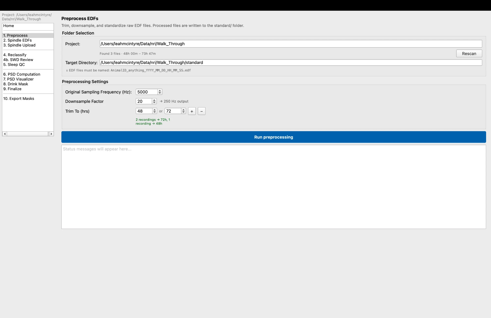
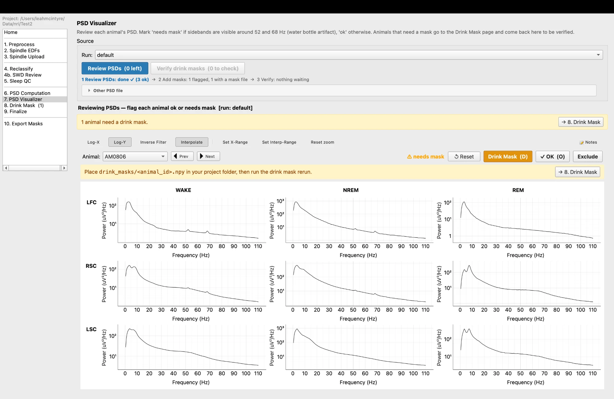
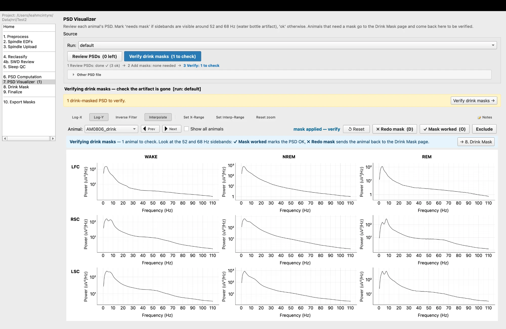

# ebb-viewer user guide

> **Status: skeleton.** Sections marked **TODO** need a walkthrough of the app with real (or demo) data, screenshots, or an answer from [open_items.md](open_items.md). The reasons behind each setting are in [decision_log.md](decision_log.md).

Each page section has the same shape: **Goal, Before you start, Steps, Check your work, If something goes wrong.**

---

## 0. What this is

ebb-viewer takes continuous EEG/EMG recordings (EDF), stages sleep with SPINDLE, corrects the staging, lets you review the quality of each animal, and computes power spectra (PSDs) and sleep-by-hour tables. It is a GUI over the `ebb` processing library.

- It builds on EBB by Matt Caudill (https://github.com/mscaudill/ebb). **TODO:** final wording of the credit (see open items).
- You need: your recordings as EDF files, a SleepyRat/SPINDLE account, and enough disk space for the copies the pipeline makes. **TODO:** disk estimate per animal.
- **TODO:** one overview figure (the redrawn pipeline flow).

## 1. Install and start

Follow [windows_setup.md](windows_setup.md) (Windows). On macOS or Linux:

```bash
pip install -e .
ebb-viewer
```

Update, verify and troubleshoot: see the same file. **TODO:** macOS/Linux notes.

## 2. Before you click anything

**Read these. Most mix-ups come from here.**

### 2.1 One project folder per time point
The animal ID is the first `_`-delimited part of the file name (`CW0DC4_P098_KO_..._PREPROCESSED.edf` is animal `CW0DC4`). If animals from different time points share a folder, their IDs collide. **Use one project folder per time point.**

### 2.2 Channel order matters
The pipeline identifies channels by position only: **1 = LFC, 2 = RSC, 3 = LSC, 4 = EMG.** It does not check names. Make sure your files follow this order.

### 2.3 Recording length
Recordings are trimmed to the largest whole number of days that fits, 72 h or 48 h. Recordings shorter than 48 h are rejected.

### 2.4 The project folder
```
<project>/
  *.edf                  raw recordings you put here
  standard/              preprocessed EDFs (250 Hz)
  spindle_edfs/<COMBO>/  channel subsets uploaded to SPINDLE
  spindle_outputs/<COMBO>/  SPINDLE results (CSV per animal; reclassification adds columns)
  swd/                   one SWD .mat per animal, if you review SWDs
  drink_masks/           drink-event files and one offsets CSV
  psd/<RUN>/             PSD results, psd_params.json, psds_final.pkl
  sleep_analysis/        outputs of the sleep notebooks
  manifest.json          per-animal status; do not edit by hand
```
**TODO:** replace with a verified tree after a real run.

### 2.5 Concepts
- **Manifest:** the pipeline's record of what each animal has done. The Home page reads it.
- **Channel combo:** one per project (e.g. `LFC_RSC`), used for every animal. `manifest.json` starts with the default `LFC_RSC` as soon as the project is opened, before you choose anything, so the file alone does not show that you chose it. It is set on the **Spindle EDFs** page: the name is built from the EEG channels you select there (the EMG is always included), and writing the EDFs stores it in `manifest.json` as the project combo.
- **States:** `w` wake, `n` NREM, `r` REM, one per 4 s epoch.
- **Original vs. reclassified:** SPINDLE's states are kept. Everything downstream reads `final_state`.
- **Statuses:** Sleep QC is `ok` / `needs_review` / `excluded`. PSD status is `ok` / `needs_drink_mask` / `drink_mask_applied`.

### 2.6 Extra files you may need

Besides the raw EDFs, some steps use extra files that **you prepare**. You only need the ones for the steps you will use:

- **Sleep staging and PSDs only:** nothing beyond the EDFs (plus a groups file if you want one for the notebooks).
- **Add SWD files** if you want SWD review (step 4b) or the SWD mask in step 6.
- **Add annotation files** if you want to mask jerks and jumps in step 6.
- **Add drink-event files and an offsets file** only if the PSD review (step 7) shows the drinking artifact.

Put each file in the project folder (the one you choose when ebb-viewer starts, section 4) unless the table says otherwise. **In every file name, the animal ID is the part before the first `_`, and it must match the EDF's animal ID exactly, including capitals** (`CW0DC4`, not `cw0dc4`).

| File | Needed for | Put it in | Name it | Where it comes from |
|---|---|---|---|---|
| **SWD file**, one per animal (`.mat`) | Step 4b (SWD Review) and the SWD mask in step 6 | `swd/` in the project folder | `AnimalID_anything.mat`, for example `CW0DC4_P098_DEL_ts.mat` | The lab's MATLAB SWD detection. An animal with no SWDs still gets a file: an empty one (see below and 4b). |
| **Annotation file**, one per animal (`.txt`) | The annotation mask in step 6 (jerks and jumps) | Any folder; `annotations/` in the project folder is easiest. You choose the folder on the PSD page. | `AnimalID_anything.txt`, for example `CW0DC4_P098_KO_….txt` | Exported from the Pinnacle recording software, where the events were annotated (labels such as `Jerk - NREM` or `Jump - REM`). |
| **Drink-event file**, one per flagged animal (`.npy`) | Step 8 (Drink Mask) | `drink_masks/` in the project folder | Exactly `AnimalID.npy`, for example `CW0DC4.npy` | Made outside ebb-viewer with the lab's drinking-detection network, run on the recording video (exported from the PVFS file). In our lab, ask Claudia. |
| **Offsets file**, one for the whole project (`.csv`) | Step 8, unless the video and the EEG started at exactly the same moment | `drink_masks/`; it must be the **only** `.csv` there | Any name ending in `.csv`, for example `offsets.csv` | You write it. For each animal, the seconds from the start of the EEG recording to the start of the video, read from the PVFS file. |
| **Groups file** (`.csv`) | The analysis notebooks (section 7), instead of typing the groups | Anywhere; next to the notebook is easiest. You type its path into the notebook. | Any name, for example `groups.csv` | You write it from your experiment records. |

**What goes inside**

- **SWD file:** a variable called `DEL_ts` holding one row per SWD, `[start, stop]`, in seconds from the start of the recording. For an animal with no SWDs, make an empty file; the one-line command is in **4b. SWD Review** (section 6).
- **Annotation file:** use it exactly as exported (tab-separated, six lines of header, then a row per event with the columns `Time From Start` and `Annotation`). In step 6 you type keywords that appear in the annotation labels, such as `Jerk, Jump`.
- **Drink-event file:** a list of True/False values, **one value per second of the recording**, with True where the animal was drinking.
- **Offsets file:** two columns, `Animal` and `Offset`, one row per animal. The offset is in seconds, and **positive means the video started after the EEG**. Get these values manually from the PVFS file. For example (made-up numbers):

```
Animal,Offset
CW0DC4,125
CW0DB1,98
```

- **Groups file:** the easiest layout is one row per animal, with the columns `animal` and `group`:

```
animal,group
Mice-1248,WT
Mice-1251,MUT
```

  One column per group (the group name on top, its animals below) also works. Details: "Listing groups in a CSV file" in section 7.

**Restarted recordings:** the SWD and annotation files of an animal whose recording was restarted are combined together with its EDFs (section 3).

**Files ebb-viewer makes for you** (do not create these): `standard/`, `spindle_edfs/`, `spindle_outputs/`, `psd/`, `exports/`, and `manifest.json`.

## 3. Prepare your recordings: combine restarted recordings

**Skip this section if every recording ran the full duration continuously.**

Sometimes a recording stops early and is restarted, so one animal ends up with several short EDF files (for example `CW0DC4_P096_...edf` and `CW0DC4_P098_...edf`, each about a day long). The pipeline needs one file per animal, so combine them **before you open the app**. This is a command-line step; there is no page for it.

**What it does**
- Finds every EDF shorter than the nominal length (72 h by default) and groups the files by animal (the text before the first `_`).
- Orders each animal's chunks by start time (read from the EDF header), keeps the **first 24 hours of each chunk**, and joins them into one file named `<first chunk's name>_COMBINED.edf`. Two chunks give 48 h, three give 72 h.
- Does the same for the animal's SWD `.mat` files and Pinnacle annotation `.txt` files, so their times line up with the combined EDF. (Each is shifted by 24 h per chunk and ordered by the `_P###` number in its name.)
- Files with no companion chunk are left alone for SWD and annotations.

**Before you start**
1. Put the EDFs in the project folder, the SWD `.mat` files in a folder, and the annotation `.txt` files in another (for the walkthrough: `swd/` and `annotations/`).
2. Check that every chunk of an animal shares the same first token in the file name, and that the `_P###` numbers sort in the order the chunks were recorded.
3. **Every EDF shorter than the nominal hours in the folder must have a companion chunk.** A lone short recording stops the run with "No match found for token".
4. Each chunk must be at least 24 h long. Chunks shorter than 24 h are **not handled**: the combined recording would not line up with whole days.
5. The restart gap is **not corrected**: the combined recording is treated as continuous, so clock time within the combined file can drift from true clock time by the time between the end of one chunk's 24 h and the start of the next chunk (22 minutes for `CW0DC4` in the walkthrough). The number of animals that were combined can be reported in your methods.

**Steps** (from a terminal with the `ebb-dev` environment active):

1. Combine the SWD files and the annotation files. These run in seconds.
```bash
ebb-combine swd --dir /path/to/project/swd --move-short-files
```
```bash
ebb-combine annotations --dir /path/to/project/annotations --move-short-files
```
2. Combine the EDFs. This reads and writes many gigabytes and can take several minutes.
```bash
ebb-combine edf --dir /path/to/project --fs 5000 --move-short-files
```

Each command prints the files it combines and writes. The three commands can be run in any order. If you have no SWD or annotation files, skip those commands.

**Options you may want to change** (add them to the command; run `ebb-combine <edf|swd|annotations> --help` for the full list):

| Option | Default | When to change it |
|---|---|---|
| `--fs` (edf only, required) | none | Your recording's sampling rate in Hz. 5000 for our recordings. |
| `--move-short-files` | off | Add it. Moves the original chunks to a subfolder so only the combined files remain. Without it the chunks stay in the project folder and Preprocess processes them too. |
| `--short-dirname` | `short_files` | Name of the folder the chunks are moved into. |
| `--amount-hours` | 24 | Hours kept from each chunk. Keep 24: it makes the combined recording whole days, so no hour is counted more often than another in the PSDs. Use the same value for all three commands. |
| `--nominal-hours` (edf only) | 72 | Recordings shorter than this are treated as chunks to combine. Raise or lower it only if your full-length recordings are not 72 h (all EDFs under this length in the folder must have a companion chunk). |
| `--pattern` | first part of the name before `_` | A regular expression that picks out the animal ID from a file name. Change it only if your animal ID is not the first `_`-delimited part. |
| `--overwrite` | off | Replace an existing `_COMBINED` file instead of stopping. |
| `--quiet` | off | Print less. |
| `--label-preference` (swd only) | `final_ts` | The variable inside the `.mat` file that holds the SWD times. If that name is not in the file, the first variable is used (our files use `DEL_ts`, which works). |
| `--header-rows`, `--time-col`, `--delimiter` (annotations only) | 6, `Time From Start`, tab | Only if your annotation files come from a different export than Pinnacle's default. |

**Naming rules the commands rely on**
- The animal ID (the text before the first `_`) must be the same in every chunk of an animal, and different between animals.
- The SWD and annotation chunks are ordered by the number after `_P` in the file name (`_P096`, `_P098`), the EDF chunks by the start time in their header. The two orders must agree.

**Memory:** The EDF step loads a full 24 hours of each chunk into memory at once. At 5000 Hz with four channels that is about 14 GB per chunk, and the combined data is held twice while it is joined, so a two-chunk animal needs roughly 55 GB free. **Close other programs first.** On the 48 GB Mac used for the walkthrough, the first attempt was killed by the system for running out of memory; it succeeded after other memory-hungry programs were closed. A three-chunk animal needs more. Allow several minutes and about 7 GB of disk per two chunks.

**Check your work**
- Each animal that was restarted now has a `*_COMBINED.edf` (and `*_COMBINED.mat`, `*_COMBINED.txt`). The combined file keeps the name of the first chunk, with `_COMBINED` added.
- The chunks are in `short_files/` and the project folder holds one EDF per animal.
- The combined EDF is 48 h or 72 h. In the walkthrough, `CW0DC4_P096_..._COMBINED.edf` has 172,800 one-second records, exactly 48.0 h (about 6.9 GB), and the two chunks are in `short_files/`.

**If something goes wrong**
- "No match found for token ...": a short EDF has no companion. Move it out of the folder, or check the file names.
- "Refusing to overwrite existing file": rerun with `--overwrite` if you want to replace a previous `_COMBINED` file.
- Reruns skip files that already end in `_COMBINED`.

Other options (`--amount-hours`, `--nominal-hours`, `--pattern`) are listed with `ebb-combine edf --help`. The reasons for the 24 h per chunk rule are in the [decision log](decision_log.md).

## 4. Start a project

1. Make a new folder for **one time point** (see 2.1).
2. Put the raw EDF files in it, and nothing else.
3. Run `ebb-viewer`. A dialog titled "Select project folder (contains original EEG EDFs to be processed)" opens. Choose the folder.
4. The main window opens with the pipeline pages in the left sidebar. There is no "new project" button: choosing a folder starts a project, and choosing the same folder later resumes it.
5. The app creates `manifest.json` and the other folders (`standard/`, `spindle_edfs/`, and so on) as the steps run. The folder tree is in 2.4.

**Home will look empty at first.** Animals only appear on Home after Preprocess has written `standard/`. Your raw EDFs are not listed until then. This is expected.

To resume a project later, start `ebb-viewer` and choose the same folder.

## 5. Quick start

A checklist of the whole run, in order. 

1. Combine any restarted recordings (section 3). Put the raw EDFs in a new project folder; open it in ebb-viewer (Home).
2. Preprocess, then write the SPINDLE EDFs (this sets the project's channel combo).
3. Upload to SleepyRat, wait, download the CSVs.
4. Reclassify. (Optional: SWD review.)
5. Sleep QC: look at the Overview, review flagged animals, mark each OK or Exclude (with a reason).
6. Compute PSDs; review them; flag drink-mask artifacts.
7. Drink Mask: rerun flagged animals; verify.
8. Finalize.
9. Sleep analysis in the notebook; export masks if needed.

## 6. Page reference

### Home
**Goal:** see where the project stands, and what needs your attention.
**Before you start:** You have chosen the project folder (section 4). Home is empty until Preprocess has run; the page says so, and counts the EDF files it finds in the folder.

**How to read it, top to bottom:**
1. **Progress strip.** One chip per pipeline step, plus a "next step" banner with an **Open →** button. Click a chip to jump to that page. This tells you where you are.
2. **Animals table.** One row per animal with its status in each step. Use it to see whether any animal is missing a file (for example no SPINDLE output, no SWD file) or has a pending flag. The **PSD run** filter picks which PSD run's statuses are shown.
3. **Needs Attention.** Cards for animals that need action: animals flagged `needs_review` in Sleep QC (with the metrics that flagged them), and animals flagged for a drink mask. Review cards have **Open EDF** and **✓ OK**; drink mask cards link to the Drink Mask page. This is where you go to review the animals you marked "needs review" in Sleep QC.

**Other controls:** **Import new animals** re-scans `standard/` (this also happens whenever you open Home) and never overwrites existing flags. **Refresh** and **Reveal in Finder** do what they say. Double-click a row's notes cell to edit that animal's notes.
**Notes:** Notes are for your own comments during Sleep QC and PSD review. A note (the reason) is required when you exclude an animal.
**Check your work:** The animals table lists every animal you expect (the count equals the number of EDFs after Preprocess).
**If something goes wrong:** An animal missing from the table means its preprocessed EDF is not in `standard/`.
**Top of the page:** the project's **channel combo** is shown next to the title. It says "(default; set on 2. Spindle EDFs)" until you have written the SPINDLE EDFs, after which it shows just the combo.


### 1. Preprocess
**Goal:** turn the raw EDFs into trimmed, downsampled copies in `standard/`, which every later step uses. The raw files are not changed.

**Before you start**
- The project folder holds one EDF per animal (combine restarted recordings first, section 3). Preprocess processes every `.edf` directly in the project folder.
- Channel order is LFC, RSC, LSC, EMG (section 2.2).
- File names look like `AnimalID_anything.edf`: the animal ID is the text before the first `_`. Nothing else about the name matters.

**Steps**
1. Open **1. Preprocess** in the sidebar. The page scans the folder and reports, for example, "Found 3 files · 48h 00m – 73h 47m". **Rescan** repeats the scan.

   
2. Check the settings:

   | Setting | Default | Change it when |
   |---|---|---|
   | Original Sampling Frequency (Hz) | 5000 | Your recordings were not acquired at 5000 Hz. |
   | Downsample Factor | 20 | Leave at 20 (5000 → 250 Hz). The page shows the resulting rate; the original rate must divide evenly by the factor or **Run preprocessing** stays disabled. The rest of the pipeline assumes 250 Hz. |
   | Trim To (hrs) | 48, 72 | Our project uses whole days (48 or 72 h) and leaves this alone. Other projects can change it: each recording is trimmed to the longest target that fits, and targets can be as short as 1 hour. Use **+** / **−** to add or remove targets. Recordings shorter than the smallest target fail. |

   Under the settings, a line tells you how many recordings will go to each length (in the walkthrough: "2 recordings → 72h, 1 recording → 48h") and warns in red about any recording that will fail.
3. Click **Run preprocessing**. If `standard/` already contains preprocessed files, it asks before overwriting them.
4. Watch the log box. When it finishes you see "Done: N file(s) written" and a green **→ Spindle Write** button.

**Check your work**
- `standard/` has one `<name>_PREPROCESSED.edf` per animal (a combined animal keeps `_COMBINED` in its name). In the walkthrough, the 72 h files are about 520 MB each and the 48 h file about 350 MB, roughly 1/20 the size of the originals.
- Open **Home**: the animals now appear in the table (Home lists animals from `standard/`).
- The trim hint matched what you expected (48 h or 72 h per animal).

**If something goes wrong**
- "No EDF files found": the EDFs are not directly in the project folder (subfolders are not searched).
- A red warning under the scan line says an animal has more than one EDF in the folder: these are restart chunks that have not been combined (or were left behind after combining). Combine them (section 3) and move the originals out first.
- A recording is shorter than the smallest trim target: it fails. Combine its chunks first, or lower the smallest target (only if your analysis allows it; our analyses need whole days).
- **Run preprocessing** is greyed out: the original rate is not divisible by the downsample factor.
- There is no cancel button. If you must stop, close the app and rerun; existing outputs are overwritten after confirmation.

Decisions: [log §1](decision_log.md).

### 2. Spindle EDFs
**Goal:** write a small copy of each preprocessed EDF containing only the channels SPINDLE needs, in `spindle_edfs/<COMBO>/`. This is also where the project's channel combo is set.

**Before you start:** Preprocess has run (the page says "No standard folder available. Run preprocessing first." otherwise).

**Steps**
1. Open **2. Spindle EDFs**. The page shows the standard folder, the **Channel Combo** (read-only, built from your selection, e.g. `LFC_RSC`) and the target folder.
2. Under **Channel Selection**, tick **exactly 1 or 2** of Ch0 (LFC), Ch1 (RSC), Ch2 (LSC). **Ch3 (EMG) is always included** and cannot be unticked. Ch0 and Ch1 are ticked by default, giving `LFC_RSC`, the combo we use. Two channels is generally best because SPINDLE then has more data to score from; choose one only if the second channel is unusable.
3. When the status line is green ("2 EEG channels selected — ready to run"), click **Run Spindle Preprocessor**. If files already exist for that combo it asks before overwriting.
4. When the green "Done. Spindle EDFs written." bar appears, click **→ Spindle Upload**.

**What it does:** writes `<name>_SPINDLE.edf` for every animal (EEG channels you chose plus EMG, at the preprocessed 250 Hz). **When it finishes, the combo is saved as the project's combo in `manifest.json`, and every later page uses it.** (`manifest.json` already says `LFC_RSC` from the start, as a default; this step is where it becomes your choice.)

**Choose the combo once for the whole project.** Every animal must use the same one, so that sleep is compared across animals scored the same way. Running the page again with a different combo writes a second folder and **changes the project combo** to the new one; the old folder stays on disk but is no longer used. Every later page reads the combo from the manifest, so animals uploaded and downloaded under the old combo would have to be uploaded again under the new one (from the code; not tested). Decide on the combo before you upload.

**Check your work**
- `spindle_edfs/<COMBO>/` (for the default, `spindle_edfs/LFC_RSC/`) has one `*_SPINDLE.edf` per animal. The folder is created for you.
- The Channel Combo field shows the combo you intended.

**If something goes wrong**
- The Run button is greyed out: you have 0 or 3 EEG channels ticked (the page says "Select 1 or 2 channels from Ch0–Ch2" or "Maximum is 2 channels from Ch0–2").
- "No standard folder available": run Preprocess first.

Decisions: [log §2](decision_log.md).

### 3. Spindle Upload
**Goal:** send the SPINDLE EDFs to SleepyRat for sleep scoring and download the scored label files. One button, **Upload & Download**, does both.

**Before you start**
- The Spindle EDFs step has run (the page says "Spindle EDFs need to be created before using this page" otherwise).
- You can sign in to SleepyRat (https://sleepyrat.ai/) in your browser.

**Steps**
1. Open **3. Spindle Upload**. The top line shows where files come from and go to: `spindle_edfs/<COMBO>/` → `spindle_outputs/<COMBO>/`.
2. **SleepyRat project:** choose **your own name** from the list. This is how your files are kept separate from other users' on SleepyRat. **If your name is not in the list, click "New…"**, type your name (and, optionally, a description), and it is created and selected. If your name is already in the list, do not create it again. **Refresh** reloads the list.
3. **Remote folder name:** the folder inside your SleepyRat project that holds this project's files. It is filled in for you from the project folder's name and the combo (for example `Walk_Through_LFC_RSC`); change it only if you want a different name. A line under the box tells you whether the folder already exists ("Existing folder — already-uploaded edf files will be skipped; missing labels will be downloaded") or will be created ("New folder — will be created on upload").
4. Click **Upload & Download**. The button stays disabled until a project and a folder name are set; hover over it to see what is missing.
5. **First time only:** a browser tab opens asking you to approve access for ebb. Log in with the appropriate credentials and approve it there; the app waits. The approval is remembered on this computer.
6. Watch the log. For files not yet on SleepyRat it uploads them, then waits for SleepyRat to finish scoring (this can take a long time: with many files, more than an hour is still normal, so leave the app open), then downloads one label CSV per animal.
7. When the green bar says "Done. Labels downloaded — ready to reclassify.", click **→ Reclassify**.

**It is safe to run again**
- **Uploads are skipped for files already on SleepyRat** (the log says "Skipping N already-uploaded edf file(s)"). If everything is already there it also skips the wait.
- **Downloads are skipped for label files you already have** ("Skipping N already-downloaded file(s)").
- So if all files uploaded but something went wrong before the downloads finished, just repeat the same step as normal: nothing is uploaded again, and only the missing label files are downloaded.

**Check your work**
- `spindle_outputs/<COMBO>/` has one `<name>_labels.csv` per animal. Each has one row per 4 s epoch: 64,800 rows for a 72 h recording, 43,200 for 48 h (as in the walkthrough). Columns: `index`, `noise_prob`, `state` (`w` / `n` / `r`) and the three class probabilities (`class_prob_0`–`2`).
- Open **Home**: every animal has SPINDLE output.

**If something goes wrong**
- "Output Folder Not Empty": the output folder already has files (for example from an earlier download). New CSVs are mixed in with them; choose OK to continue.
- A "SleepyRat Error" box or an ERROR line in the log: read the message; rerunning is safe. "Processing did not finish within the wait limit" means SleepyRat took too long; run again later and the finished files will download.
- Your name is missing from **SleepyRat project** after you created it: click **Refresh**.
- **TODO:** what a failed scoring job looks like, and what to do to redo the scoring of one animal (an existing label file is never overwritten, so you would delete that animal's label CSV and rerun; a freshly downloaded CSV counts as not reclassified until you rerun Reclassify).
Credit: SPINDLE scoring is provided by SleepyRat (sleepyRat Team, 2026, https://sleepyrat.ai/); the page shows this citation.
Decisions: [log §2](decision_log.md).

### 4. Reclassify
**Goal:** correct SPINDLE's staging for one known problem: wake artifacts that SPINDLE scores as NREM, which break up real bouts and inflate sleep fragmentation.

**What it does** (so you know what you are running; the reasons are in the [decision log](decision_log.md), §3, and the full algorithm in [sleep_reclassification.md](sleep_reclassification.md))
1. **Gap fill.** SPINDLE flags epochs it thinks are artifacts. A NREM epoch becomes wake if it is itself flagged, or if it is not flagged but has a flagged epoch right before and right after it. Only NREM can change, and only to wake.
2. **EMG check (the "EMG gate"), only when needed.** For some animals SPINDLE flags too much, so clean NREM gets turned into wake and creates false breaks. The check looks at the NREM bouts during the light period (when the animal should be quietest). If gap fill raised that count by more than 10%, a change is kept only if the EMG shows real muscle activity in that epoch (above the animal's typical NREM level). Otherwise the check is not applied.
3. **Your original data are kept.** Two columns are added to each animal's CSV: `reclass_state` and `final_state`. SPINDLE's own states are not changed, and a copy of the untouched file is saved in `spindle_outputs/<COMBO>/_original/`. **All later steps read `final_state`.**

**Before you start:** The SPINDLE labels are downloaded (step 3). The EMG check needs the animal's preprocessed EDF in `standard/`.

**Steps**
1. Open **4. Reclassify**. The table lists every animal that has a SPINDLE CSV.
2. Click **Run reclassification**. (If Sleep QC has already been started, it warns that rerunning changes the states the flags were judged on; the flags are not reset.)
3. When the status line says "Done: N file(s), EMG gate applied to K", click **→ Sleep QC**.

**Check your work**
- Every animal has a **✓** in the **Reclassified** column (a **—** means it has not been reclassified).
- Every animal's **EMG gate** column says either **applied** or **not needed**. "Unknown (re-run to restore)" means the gate record is missing; the result is fine, but rerun to restore the label.
- The last column shows the number of light-period NREM bouts before → after reclassification (shown after a run in this session). Applied or not applied is normal and depends on the animal. The gate is applied to an animal when gap fill raised its light-period NREM bout count by more than 10%; most animals do not need it. **In the walkthrough, all three animals show "not needed".**

It is safe to rerun.

**If something goes wrong:** Nothing has gone wrong in the walkthrough. **TODO:** record real failures as they happen (for example an EDF shorter than its CSV).
Each CSV now has two extra columns, `reclass_state` and `final_state`, after the SPINDLE columns.

### 4b. SWD Review (optional)
**Goal:** make sure that SWDs scored as NREM don't create fake genotype differences in sleep fragmentation. You step through every epoch that overlaps an SWD and correct the state where it is wrong.

**Before you start**
- Reclassify has run.
- The project has an `swd/` folder with **one `.mat` file per animal** holding the SWD start/stop times in seconds (from the lab's MATLAB detector). The file name must contain the animal ID: `CW0DB1_P118_DEL_ts.mat` and `Mice-1256.mat` both work. In the walkthrough: one file each for `CW0DB1`, `CW3209` and the combined `CW0DC4`. (Restarted recordings need their SWD files combined first, section 3.)
- **An animal with no SWDs should still have an empty `.mat` file.** This is best practice, because the SWD mask in the PSD step also looks for the file. To make one, with the `ebb-dev` environment active (use the animal's ID in the name):
```bash
python -c "import numpy as np; from scipy.io import savemat; savemat('swd/CW0DB1_DEL_ts.mat', {'DEL_ts': np.empty((0, 2))})"
```
  The page also has a **Confirm no SWD** button for an animal with no file. Use it only if you really do not want a file.

**Steps**
1. Open **4b. SWD Review** and tick **Review SWD epochs for this project**. Until you tick it, nothing on this page changes anything.
2. The table lists every animal with its progress ("—", "In progress (k of N)", or "✓ N of N"). Click **Review…** next to an animal. A trace window opens with the SWDs shaded, the state bar, and the **selected epoch highlighted in yellow**. The keyboard acts on the selected epoch.
3. For each epoch that contains an SWD:
   - If the state is right, press **Space** to go to the next SWD epoch. Moving on keeps the current state and counts the epoch as reviewed.
   - If the state is wrong, press **w**, **n** or **r** to set it, then **Space**. A misclassified SWD epoch should get the state the animal was in before and after the SWD.
   - **Shift+Space** goes back to the previous SWD epoch. **←** / **→** scroll the trace.
4. To change an epoch that does **not** contain an SWD (for example a neighbor of an SWD), **double-click** it in the trace to select it, then press **w**, **n** or **r**.
5. Click **Save**. You can save half-way and close; reopening resumes at the first epoch you haven't reviewed. Closing with unsaved changes asks first.

**Check your work**
- Each animal's progress reads "✓ N of N".
- The animal's CSV has a `swd_reclassification` column (blank except the SWD epochs you reviewed and epochs you edited) and an updated `final_state`.

**Good to know**
- Nothing is blocked if you skip animals: the Sleep QC page shows an orange warning, and the PSD, Finalize and Export Masks steps ask you to confirm. Unreviewed epochs keep their reclassified state.
- Rerunning Reclassify keeps your SWD work.

**If something goes wrong:** An animal showing "Needs file or confirmation" has no `.mat` file in `swd/`. **TODO:** record real problems as they happen, and the time a review takes per animal.
Details: [sleep_reclassification.md](sleep_reclassification.md) §5. Decisions: [log §4](decision_log.md).

### 5. Sleep QC
**Goal:** decide for every animal whether its sleep data are trustworthy. **Every animal must end up either OK or Excluded**; PSD computation does not start until all of them are. You do this in **two passes**: first in the **Sleep** view, where you mark each animal **OK**, **Review** or **Exclude**, and then on **Home**, where you look at each animal marked Review and settle it as OK or Exclude. The sleep and PSD analyses depend on these decisions, so do it carefully. Do the review **blind to genotype**. File names generally do not carry genotype, so the review is blind as long as the person doing it does not know which animal ID belongs to which group.

**Before you start:** Reclassify has run (and SWD review, if your project uses it). The page uses the reclassified states. **Show original** switches the plots to SPINDLE's original states, for comparison; nothing is written to disk.

**The page has two views** (the **VIEW** buttons at the top right): **Overview** (the default) and **Sleep** (the by-hour plots).

**Step 1: Overview.** One boxplot per metric, one dot per animal, with the raw points shown. Animals past a threshold are red and labelled.

**Why animals are flagged.** The metrics below are ones that, in our own past data, made us suspicious of a noisy or misclassified recording: many very short NREM bouts (the sleep looks chopped up), too many NREM bouts per dark hour, too much or too little of one state (REM %, NREM %, wake %), or a big spike of REM in one 2-hour stretch. They are warning signs, **not rules**: a flagged animal may be fine and an unflagged one may not be, so you still look at every animal.

| Metric | Default threshold |
|---|---|
| Short (1–2 epoch) NREM bouts per hour | above 6 |
| NREM bouts per dark hour | above 15 |
| REM % of the file | above 10 |
| NREM % of the file | below 30 |
| Wake % of the file | above 70 |
| Max REM % in any 2-hour bin | at least 35 |

Short NREM bouts and NREM bouts per dark hour are **rates** (per hour), so a 48 h and a 72 h recording are judged on the same scale. If you edit thresholds in `manifest.json`, a saved value for a metric that no longer exists (for example the old per-file short-bout count) is ignored.

An animal that passes the threshold on **any** of the six metrics usually has suspicious sleep data, which may mean noise or misclassification. These thresholds came from our own data; **use them as a starting point**, not as rules. **Animals past a threshold are flagged for review automatically** when the page loads its data, if they have no decision yet: a red line under the page description lists them ("Flagged for review automatically"), and they appear on Home under Needs Attention. Animals you have already marked OK, Excluded or Review are never changed. You can also flag any other animal yourself: **click its dot, then click "Flag for Review"**. This marks it `needs_review`. To clear an automatic flag, click **Review** again on that animal (it goes back to not decided; the page flags it again the next time it loads its data if it is still past a threshold).

**Step 2: First pass, the Sleep view.** Click **Sleep** (the **VIEW** buttons, top right) and go through **every** animal. For each, look for anything very out of place or wrong looking: is the sleep too fragmented, are the fractions of time in each state about what you would expect? Under DISPLAY, **Group** shows all animals together (page by page with **◄ Prev** / **Next ►**) and **Animal** shows a single animal at a time.
- **Time axis:** **Clock-aligned** (default), **Rotate to 6AM**, **From Start**. In clock-aligned mode the first and last bins of an animal may be shorter than 2 hours, so they can look strange. **If the first or last bin of an animal looks off, view that animal with the Time axis set to Rotate to 6AM or From Start and see whether that fixes it** before you decide. If it does, the odd bin was only the partial bin at the edge of the recording, not a problem with the animal.
- **Median** draws a group-median reference line on the plots, so you can see how an animal compares with the others.
- For each animal press **OK** (the sleep scoring looks fine), **Review** (something looks off and you want to look at the actual recording) or **Exclude** (it is clearly wrong or noisy; a reason is required, see below).

**Step 3: Second pass, Home.** Go to **Home**. The **Needs Attention** section lists every animal marked **Review**, including the ones flagged automatically. A card shows which metrics flagged the animal, and **[EMG gate]** (in brackets) when the EMG gate was applied to that animal during Reclassify, since the gate changes how its states were corrected. For each card, click **Open EDF**, look at the recording, and settle the animal: in the viewer's toolbar press **✓ Mark OK** or **Exclude** (a reason is required), or click **✓ OK** on the card if the animal is fine. **Review is not a final answer:** every animal marked Review must end as OK or Excluded. The Sleep QC page tells you when every animal has a decision ("All spindle metrics checked — ready for PSD computation").

**Excluding an animal.** Exclude when the sleep data look wrong and something about the EEG or EMG looks very noisy or wrong, for example lots of misclassification. Animals past a threshold should generally be excluded, but use your own judgment. **A reason is required, and it is saved with the animal.** Make it specific, so someone else can see what you saw:
- Find **where in the recording** the major misclassification happens.
- Is a **particular channel noisy**?
- Is the **sleep data simply wrong**?

An excluded animal is not deleted. Its data are still processed and kept, and it is marked as excluded in the final files so you can reverse the decision or leave it out later. Un-excluding sets the animal back to `needs_review`.

**Check your work:** every animal has OK or Excluded (no "needs review" left, and no review cards left under Needs Attention on Home), and each excluded animal has a reason in its notes (visible on Home).

**TODO:** screenshots of the Overview and the Sleep view.
Details: [sleep_qc_and_exclusion.md](sleep_qc_and_exclusion.md). Decisions: [log §5](decision_log.md).

### 6. PSD Computation
**Goal:** compute power spectral densities (PSDs) for every animal, separately for each sleep state and channel, with artifacts masked out. Animals that were excluded in Sleep QC are computed too (they are marked later, at Finalize).

**Before you start:** Sleep QC has a decision (OK or excluded) for every animal. If you will use the SWD mask, every animal needs a `.mat` file in `swd/` (an empty one is fine, see 4b). If you will use the annotation mask, the annotation files are in one folder.

**The defaults are the ones we use. Leave them alone unless you have a reason to change them.** The reasons behind each value are in [psd_methods.md](psd_methods.md) and the [decision log](decision_log.md), §6.

**The page, top to bottom**
- **WHAT TO COMPUTE**
  - **States to Compute:** wake, NREM and REM are ticked by default. Others (sleep = NREM + REM, all) are available.
  - **Channels:** all three EEG channels are ticked by default (**Select all**).
- **FILTERS & MASKS** (collapsible sections; **Restore defaults** resets them)
  - **Commutator, SD threshold, SPINDLE noise, 60 Hz notch:** defaults on; the values we use are in the decision log. Leave them.
  - **SWD mask** (we use it): choose **Mask out SWDs** (the default is "No SWD mask"). Reads one `.mat` per animal from `swd/`. **Pad each event** adds seconds on each side of every SWD (default 0 s).
  - **Annotation mask** (we use it, to remove jerks and jumps): tick **Apply annotation mask**, pick the **annotation directory**, and enter **keywords**, separated by commas. An event is masked if its label matches a keyword. **Contains** matches any label that contains the keyword (not case-sensitive); **Exact** needs the whole label to match. In the walkthrough the labels look like `Jerk - NREM` and `Jump - REM` (with the occasional `Jerk- REM`), so keywords `Jerk, Jump` with **Contains** catch all of them. **Pad before / Pad after** extend each masked event by that many seconds, for events whose duration was not annotated.
  - **Hour window** (rarely used): **Restrict to clock-time window** keeps only certain hours of the day. Useful for computing light-period and dark-period PSDs separately.
  - **Drink mask:** not used here; it is applied later on the Drink Mask page.
- **Advanced:** sampling frequency (250 Hz). The **↻** button reads it from the first EDF in `standard/`. Do not change it for our data.
- **RUN**
  - **Run name:** the name of the folder under `psd/` that the results go in (default `default`). Choose a name that says what the run is for, for example `default`, `notch_filter`, `final_run`. You can keep several runs side by side.
  - **THIS RUN** summarizes what will be computed and which masks apply. Read it before you run.
  - **READINESS:** a checklist that makes sure you are not missing anything. A ✓ means ready, a ✗ (red) blocks the run, a ⚠ (amber) is a warning. It checks that the standard EDFs and SPINDLE CSVs exist, that every animal has a Sleep QC decision, that at least one state and channel are selected, that SWD files exist for every animal (when the SWD mask is on), and that the annotation mask has a directory and a keyword (when it is on). If a check fails, an **Open … →** button takes you to the page that fixes it.

**Steps**
1. Open **6. PSD Computation** and check that the READINESS list is all ✓.
2. Turn on the masks you want (for us: SWD mask and annotation mask).
3. Enter a **run name**.
4. Click **Run PSD Pipeline**.
5. When the green bar says "PSDs computed — ready for PSD review", click **→ PSD Visualizer**.

The run can take anywhere from a couple of minutes to an hour or more, depending on your computer and the number of animals.

**Check your work:** `psd/<run name>/` has `psd_params.json` (the exact settings used) and `psds_<COMBO>.pkl`. **TODO:** exact files after a walkthrough run.

**If something goes wrong:** If **Run PSD Pipeline** is greyed out, read the red ✗ lines in READINESS. An animal with no annotation file is still computed, just **without** the annotation mask (the walkthrough animal `CW3209` has no annotation file and runs this way). The READINESS list shows an amber warning naming the animals with no annotation file (it does not block the run), so check that every animal that should have one does. Record real failures as they happen.
**TODO:** screenshot.
Details: [psd_methods.md](psd_methods.md). Decisions: [log §6](decision_log.md).

### 7. PSD Visualizer
**Goal:** look at every animal's PSDs and decide: is the PSD fine (**OK**), does it show the drinking artifact (**Drink Mask**), or should the animal be **excluded**. Only animals marked `ok` in Sleep QC are reviewed here.

**What you are looking for:** a drinking (water bottle) artifact shows up as **sidebands around 52 and 68 Hz**. If you see them, flag the animal for a drink mask; otherwise mark it OK. Flagged animals go to the **Drink Mask** page and come back here to be verified. In the example below, an animal was flagged **Drink Mask**: look at the LFC plots for WAKE and NREM, where small peaks stand out near 52 Hz and 68 Hz on either side of the 60 Hz line-noise gap. The REM plots, and the LSC plots, are smooth. **Interpolate** is switched on here, and the y-axis is logarithmic.



**TODO:** a "normal" example without sidebands.

**Before you start:** PSDs have been computed (step 6).

**Steps**
1. Open **7. PSD Visualizer**. Under **Source**, choose the **Run** (the run name from step 6).
2. Pick the pass with the two buttons, each of which shows how many animals are waiting:
   - **Review PSDs:** the first review of every animal.
   - **Verify drink masks:** check animals that were re-run with a drink mask (shown after step 8). The page opens on the pass that is next.
3. **Turn on Interpolate and Inverse Filter** for the review (we use both for every animal; they only change the display). For each animal (choose with **Animal:** or **Prev** / **Next**, or the **←** / **→** keys), look at the grid of PSDs (one plot per channel and state) and press:
   - **✓ OK** (key **O**): the PSD looks fine.
   - **Drink Mask** (key **D**): the sidebands are visible. (In the verify pass these buttons read **✓ Mask worked** and **✗ Redo mask**.)
   - **Exclude**: leave the animal out (no keyboard shortcut, on purpose). **Do not exclude an animal from its PSD alone.** Look into the PSD separately first (for example in the EEG viewer) and exclude only if you cannot find a solution. A reason is required, as in Sleep QC. Clicking Exclude again sends the animal back to Sleep QC review.
   - **↺ Reset** clears the animal's review status. **📝 Notes** adds a note for the animal.
4. When every animal has been reviewed, the page says "All animals in this run reviewed" and shows **→ Finalize**. Animals flagged for a drink mask have to be finished first (step 8 and the verify pass).

**The toolbar** (these change only how the plot looks)
- **Log-X** and **Log-Y** switch the axes (Log-Y is on by default).
- **Interpolate** draws a straight bridge over the line-noise gap (56–64 Hz if the run used the notch filter, 58–62 Hz otherwise). **Set Interp-Range** changes the range.
- **Inverse Filter** multiplies the lowest frequencies (0.5–3.5 Hz) by a set of correction factors, to compensate for the low-frequency roll-off of the recording hardware.
- **Set X-Range** and **Reset zoom** set the frequency range shown.
- **Interpolate and Inverse Filter are display-only.** They do not change the saved PSD files or any export; they only change what you see on the screen.

An excluded animal shows a banner and its PSD is still displayed. **Other PSD file** (collapsed) lets you open any other `.pkl` for viewing only (no flagging).

**Check your work:** every animal has a status: OK, or Excluded with a reason (the `needs_drink_mask` ones are finished in step 8).

**If something goes wrong:** **TODO.**
Details: [sleep_qc_and_exclusion.md](sleep_qc_and_exclusion.md) §5. Decisions: [log §6](decision_log.md).

### 8. Drink Mask
**Goal:** recompute the PSDs of the animals you flagged **Drink Mask** in step 7, with drinking events masked out, so the 52 and 68 Hz sidebands go away.

**Before you start**
- At least one animal is flagged `needs_drink_mask` in the PSD Visualizer.
- **A drink-event file for each flagged animal**: `drink_masks/<AnimalID>.npy`, a 1 Hz array with one true/false value per second of the recording. These files are made **outside this pipeline**, with the lab's network that detects drinking events from the recording video. The video has to be exported from the PVFS file. **In our lab, ask Claudia.**
- **One offsets CSV in `drink_masks/`** (only needed if the video and the EEG did not start at the same moment; with no CSV the page assumes they are aligned) with the columns `Animal` and `Offset` and one row per animal. The offset is the time, in seconds, from the start of the EEG recording to the start of the video (a positive number means the video starts after the EEG). Get these values manually from the PVFS file. Keep only one CSV in the folder. **TODO:** paste a small example of the CSV here.

**Steps**
1. Open **8. Drink Mask**. The ANIMALS line tells you how many are flagged, how many are ready to apply and how many are missing a mask file (for example "1 flagged · 1 ready to apply"). The **Video offset CSV** section (collapsed) shows whether the offsets file is valid.
2. Choose the **PSD run** (the run you reviewed in step 7). The page rebuilds that run's settings exactly (see "THIS RERUN") and adds the drink mask. Each drinking event is padded by 2 s on each side.
3. Check **READINESS**: the run has saved settings, the standard EDFs exist, at least one animal is flagged, every flagged animal has a mask file (an animal without one is skipped), and the offsets CSV is valid.
4. Click **Apply Drink Masks**. Only the flagged animals are recomputed. Their results go in separate files (`psds_<COMBO>_drink.pkl`); the original PSDs are never overwritten.
5. When it finishes, click **→ PSD Visualizer** and use the **Verify drink masks** pass.

**Verify.** In the PSD Visualizer, **Verify drink masks** lists the recomputed animals (named like `AM0806_drink`). A good mask is one where **the sidebands are gone**: press **✓ Mask worked** (key `O`) to mark the animal OK. If they are still there, press **✗ Redo mask** (key `D`) to send the animal back to this page. In the example, the 52 and 68 Hz peaks seen before masking (step 7) are gone.



**Check your work:** each recomputed animal shows "mask applied — verify" until you have verified it, and then OK. Finalize waits until no animal is flagged or waiting to be verified.

**If something goes wrong**
- "No mask files yet": put `<AnimalID>.npy` in `drink_masks/` for the animals listed.
- "Several CSVs in drink_masks/": keep only one offsets file.
- "Offset CSV needs 'Animal' and 'Offset' columns": fix the header.
- **TODO:** record real failures as they happen (for example a mask file that belongs to a different recording).
Decisions: [log §6](decision_log.md).

### 9. Finalize
**Goal:** finish the PSD part of the project. Finalize **seals** each PSD run into one file, `psd/<run name>/psds_final.pkl`, which is **the file to use for analysis**. Sealed means all the computation is done.

**Before you start:** every animal in the run has been reviewed (OK, excluded, or drink mask verified). The run's card shows "✓ All animals reviewed" when you are ready, or what is still pending ("2 need review", "1 needs a drink mask", "1 to verify").

**Steps**
1. Open **9. Finalize**. There is one card per PSD run, with its status, any excluded animals, and the **source file** that will be sealed (the drink-mask version when you used drink masks, otherwise the plain PSD file).
2. To see the exact settings that run used, click **Settings…** on the card (states, channels, sampling frequency, artifact-mask values, hour windows, SWD, drink and annotation masks).
3. Click **Finalize**. If SWD review is on and unfinished, it asks you to confirm first. When it finishes you get "psds_final.pkl written for run '<run name>'".
4. Optionally click **Export to Excel**: it writes a workbook with one sheet per channel and state (column A is frequency, then one column per animal) for use in Prism. If animals were excluded, an extra `excluded_animals` sheet lists them and the reasons.

**What it does with excluded animals:** they are **kept** in `psds_final.pkl`, and every record is marked `excluded` / `exclusion_reason`. A list is also saved as `excluded_animals.csv` next to it. Leave them out when you analyze.

**What you do next:** analyze `psds_final.pkl` with the PSD analysis notebook (section 7). For sleep, use the sleep notebooks, also in section 7; they read the reclassified states and leave out excluded animals.

**Changing something afterwards:** Finalize is a copy of the latest PSD file, written again each time you click it, so clicking **Finalize** again replaces `psds_final.pkl` for that run (from the code; not tested). If you change something that affects the PSDs themselves, such as masks or settings, run a new PSD run under a new name and finalize that one. **TODO:** confirm the safe way to make changes after Finalize.

**Check your work:** the card shows when `psds_final.pkl` was last written. The home page marks Finalize as done.
**TODO:** screenshot.
Decisions: [log §8](decision_log.md).

### 10. Export Masks
**Goal:** export the artifact masks (and the sleep states) as time-stamped CSV files, **without computing PSDs**. Use it when you want the masks for something else, or want to use the artifact masking outside this pipeline.

**Steps**
1. Open **10. Export Masks**. Choose the run or settings you want: **Load from PSD run…** copies the settings of a PSD run you already made, and **Load from saved export…** reuses an earlier export. **Restore defaults** resets them.
2. Set **what to export** (states, channels, sampling frequency) and the **filters and masks** (the same kinds as on the PSD page: commutator, SD, SPINDLE noise, SWD, annotation, and so on). Pick the animals under **Animals** (**Select all** / **Select none**).
3. Name the export in **Output**; files go in `<project>/exports/<name>/`.
4. Click **Export**. Use **Open exports folder** to see the results.

**Output:** for each animal, in the export folder:
- `<animal>_<combo>_states.csv`: the sleep states as intervals.
- `<animal>_<combo>_artifacts.csv`: the time windows that were masked, with the source of each (for example commutator or SD threshold).
- `<animal>_<combo>_clean_per_state.csv`: the clean windows left for each state.
- `<animal>_<combo>_meta.json`: the settings used.
Each CSV has the columns `start_s`, `end_s`, `start_sample`, `end_sample` and a label column (`state` or `source`). Times are in seconds from the start of the recording. A file with no intervals still has the header.

**Excluded animals:** they are **not** marked in the export. To see which animals were excluded in Sleep QC, check the manifest (the Home page's animals table, or `manifest.json`), where each excluded animal's status is `excluded` and its reason is in the notes. Leave them out of your use of the masks, or deselect them in the **Animals** list before exporting.

**TODO:** screenshot; a short note on what a user typically does with these files.
Decisions: [log §8](decision_log.md).

### The EEG viewer
**Goal:** scroll and zoom traces, see the state bar and masks. Keys: `w`/`n`/`r` jump between state spans in the trace view. **TODO:** full shortcut list, masks dock.

## 7. Analysis notebooks

The pipeline ends at `psds_final.pkl` and the reclassified sleep states. Two sets of notebooks in `notebooks/` turn them into tables and plots. In each case, copy the notebook (and, for PSDs, the helper file) into your analysis folder, edit the Settings cell, and Run All.

### Listing groups in a CSV file

All three notebooks (PSD analysis, sleep by hour, and its step-by-step walkthrough) can read the experimental groups from a CSV file instead of a typed `GROUPS` list. Set `GROUPS_CSV` to the file's path, for example `GROUPS_CSV = Path("groups.csv")`. It replaces `GROUPS`.

**Recommended: one row per animal**, with columns named `animal` and `group`:

```
animal,group
Mice-1248,WT
Mice-1253,WT
Mice-1251,MUT
Mice-1279,MUT
```

This is the easier format to keep correct: each animal appears once, so an animal cannot end up in two groups by accident, you can sort or filter it in a spreadsheet, and the animals can be in any order. Other columns (for example `sex`) are ignored.

**Also accepted: one column per group**, the group name in the first row and the animal IDs below it:

```
WT,MUT
Mice-1248,Mice-1251
Mice-1253,Mice-1279
```

This is quick to type when you are listing groups side by side (and matches how Prism lays them out), but the columns end up ragged when the groups differ in size. Blank cells are skipped.

The notebook tells the two layouts apart by the header: if the first row has columns named `animal` and `group` it is read as one row per animal, otherwise as one column per group (so do not name a group "animal" or "group" in that layout). Animal IDs are the part of the file name before the first `_`, as everywhere else. Spaces around names are ignored, and upper or lower case in the `animal` / `group` headers does not matter. An animal listed in two groups, or a row with an animal but no group, stops the notebook with a message naming the line.

### PSD analysis

`notebooks/psd_analysis.ipynb`, with `notebooks/psd_utils.py`. **Copy both files into the same folder.**

**Settings to edit**
- `RUNS`: the sealed file for each time point, `{label: path to psd/<run>/psds_final.pkl}`. One entry for one time point; add a second (for example `pre` and `post`) to compare time points.
- `GROUPS`: `{group: [animal IDs]}`, or `GROUPS_CSV`: the path to a CSV file that lists the groups (see "Listing groups in a CSV file" below). Leave both empty for one group with everyone.
- `OUT_DIR`: where the results go (see below); the default is fine for most projects.
- Usually leave alone: `INCLUDE_EXCLUDED` (False: animals excluded in Sleep QC or in PSD review are left out), `APPLY_INVERSE_FILTER` (True), `INTERP_RANGES` (see below), `NORM_BAND` (1–100 Hz), `BANDS`, `FREQ_RANGE`, `COLOR_MAP`, `SEX_MAP` (orders Prism columns males first).

**What it does**
1. Loads each `psds_final.pkl` and prints which excluded animals were left out, each with its reason (which starts with the step that excluded it: Sleep QC or PSD review).
2. Applies the low-frequency correction (the "inverse filter", 0.5–3.5 Hz). **This is where the correction is applied; the saved PSD files do not include it.**
3. Bridges the line noise by interpolation (`INTERP_RANGES`, default 56–64 Hz and 118–122 Hz; see below), and builds a *normalized* spectrum (each spectrum divided by its own power from 1 to 100 Hz).
4. Plots group mean spectra with standard-error bands (channel by state), the low-frequency view, the normalized spectra, and (with two time points) every group at every time point overlaid.
5. Plots one line per animal, to spot an animal that differs from the rest.
6. Computes power in each band (the area under the spectrum) for the interpolated and the normalized spectra, saves them as CSV, and draws box plots with every animal as a dot. Outliers (beyond 1.5 × the interquartile range, within each state, channel and group) are outlined and labelled with the animal ID.
7. Writes workbooks for GraphPad Prism: spectra and band power, raw and normalized, one per time point, one sheet per channel and state.

**`INTERP_RANGES`: leave it unless you turned the notch off.** The default, 56–64 Hz and 118–122 Hz, is for PSDs computed with the 60 Hz notch filter, which is on by default in ebb-viewer (its stopband is 57–63 Hz, so 56–64 Hz covers it). The 118–122 Hz range is for the 120 Hz peak, which the notch does not touch. **If you computed the PSDs with the notch filter turned off, change it to `[[58, 62], [118, 122]]`.** The notebook prints the ranges it used when it loads the data.

**Outputs** are in `OUT_DIR`. Unless you set it, that is a folder called `psd_analysis` in the project of your first `RUNS` file, next to its `psd/` folder (for `/data/KCNT1/psd/default/psds_final.pkl`, `/data/KCNT1/psd_analysis/`); it is never the folder the notebook sits in. The notebook prints the folder in a banner ("RESULTS WILL BE SAVED IN") when it loads, and again ("ALL RESULTS ARE IN") when it finishes, and the Settings cell has a marked block explaining `OUT_DIR`. To put results somewhere else, set `OUT_DIR = Path("/path/to/results")`. The folder holds: `figures/` (PNGs), `band_power.csv`, `band_power_normalized.csv`, and the `prism_*.xlsx` files.

**If something goes wrong**
- "The inverse filter needs 7 frequency bins ... (0.5 Hz resolution)": the PSDs were computed at another resolution. Set `APPLY_INVERSE_FILTER = False`, or ask whether the correction applies to your data.
- "Not in any group" lists animals missing from `GROUPS`; "In GROUPS but not in the data" lists animals that were not found (a misspelled ID, or an excluded animal).
- A file written on Windows opens fine on macOS or Linux.

### Sleep analysis

Copy `notebooks/sleep_by_hour.ipynb` for each analysis, edit the Settings cell, Run All. Use `sleep_by_hour_walkthrough.ipynb` to see how the numbers are made.
**Settings to check:** `PROJECT_ROOT`, `GROUPS` (or `GROUPS_CSV`, see above), `INCLUDE_EXCLUDED`, `BIN_HOURS` (2), `BEGIN_HR` (6 = lights on), `TZ` (**default `America/Chicago`: change it**), `STATE_COLUMN` (`final_state`).
**Outputs** in `<project>/sleep_analysis/`: Prism workbooks, tidy CSVs, PNG plots. Metrics: fraction of time, bout count, bout duration. See [log §9](decision_log.md).

## 8. Common tasks

**TODO** (each as Goal/Steps):
- Add animals to an existing project
- Redo one animal
- Exclude and un-exclude an animal (un-exclude goes back to `needs_review`)
- Redo PSDs with different parameters
- Hand off a finished project

## 9. Troubleshooting

**TODO:** by symptom. Known ones: a page is greyed out or asks to confirm (an earlier step is incomplete); `NotReclassifiedError` (run Reclassify first); a re-downloaded SPINDLE CSV shows as not reclassified (rerun Reclassify); upload skipped everything (files already on the remote); mismatched sampling rate; empty PSD file.

## 10. Reference

**TODO:**
- Output files: `psds_final.pkl`, `excluded_animals.csv`, CSV columns (`rawstate`, `reclass_state`, `swd_reclassification`, `final_state`)
- Glossary (ZT, bout, epoch, SWD, commutator, SPINDLE noise)
- Parameter defaults (copy from [psd_methods.md](psd_methods.md) once it is corrected)
